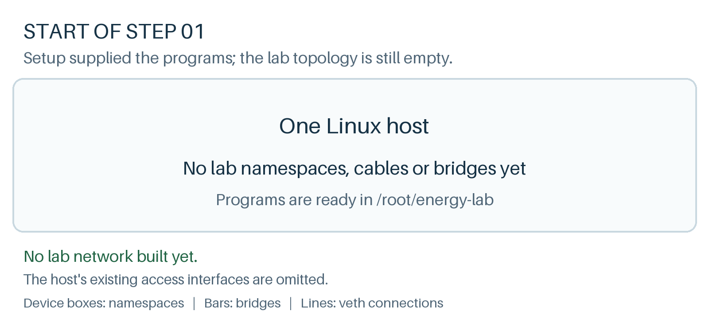

# Give each device its own network view

**Where we are**

Setup has supplied the programs, but no lab namespaces, veth pairs or bridges exist yet.



**Goal:** separate network stacks before connecting anything.

A normal Python process inherits its parent's network namespace. Starting three processes in one terminal would therefore give them the same interfaces, routes and TCP port space. A **network namespace** provides a separate set of those objects. It does not create a VM or copy the filesystem.

First inspect the host. `-br` means brief output:

```bash
cd /root/energy-lab
ip -br link
ip route
```{{exec}}

You are seeing the Ubuntu host's interfaces and routes. Leave its existing connections alone: the browser terminal depends on them.

Create the sensor's namespace, then inspect it:

```bash
ip netns add lab-s1
ip -n lab-s1 -br link
```{{exec}}

**Expected:** only `lo`, the loopback interface, initially down. There is no Ethernet interface and no inherited host connection. Bring loopback up so processes in this namespace can use their own loopback network:

```bash
ip -n lab-s1 link set lo up
```{{exec}}

Create the other two devices the same way:

```bash
ip netns add lab-ld1
ip -n lab-ld1 link set lo up
ip netns add lab-led1
ip -n lab-led1 link set lo up
ip netns list
```{{exec}}

| Namespace | Process we will run there |
|---|---|
| `lab-s1` | Sensor1 |
| `lab-ld1` | Logical device LD1 |
| `lab-led1` | LED1 |

Compare these two ways of looking at the sensor's stack:

```bash
ip -n lab-s1 -br link
ip netns exec lab-s1 ip -br link
ip netns exec lab-s1 ls /root/energy-lab
```{{exec}}

`ip -n lab-s1 ...` directs the `ip` utility to that namespace. `ip netns exec lab-s1 COMMAND` runs an arbitrary program there. We will use the second form to launch Python programs and packet captures.

**Expected:** the two interface listings describe the same loopback-only network, while `ls` still sees the shared application files. Loopback may show operational state `UNKNOWN`; check its `UP` flag rather than expecting an Ethernet-style carrier state.

**Explain before continuing:** why can the sensor read the same files as LD1 but still have no way to send it an Ethernet frame? The filesystem is shared; the network stacks are separate and have no connection yet.

Click **Check** to verify the three namespaces and their loopback interfaces.
