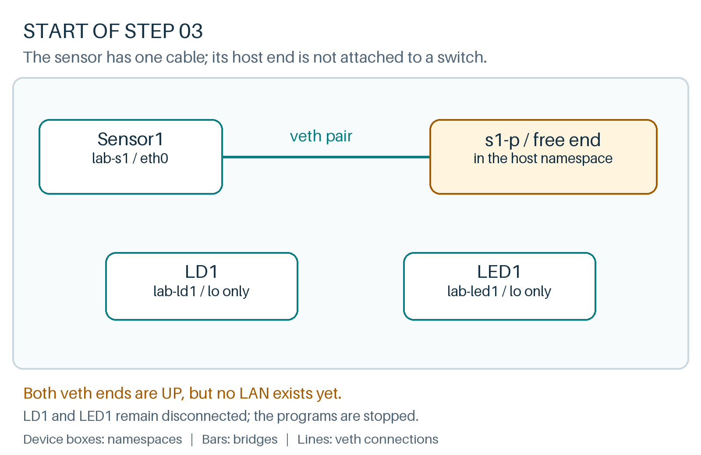

# Turn three cables into a LAN

**Where we are**

Sensor1 has an enabled veth connection from its eth0 to the host's s1-p. That host end is still unattached; LD1 and LED1 have no Ethernet connections.



**Goal:** connect Sensor1, LD1 and LED1 through a virtual switch.

A **Linux bridge** forwards Ethernet frames between its ports. It learns source MAC addresses like an Ethernet switch. We will keep the bridge and all switch-side ports in the host namespace.

Create the switch and plug in the sensor cable you already built:

```bash
ip link add br-s1 type bridge
ip link set br-s1 up
ip link set s1-p master br-s1
```{{exec}}

Here `master br-s1` is Linux's command syntax for making an interface a bridge port. It does not refer to a SCADA master.

Add LD1's cable. Read each operation as: create pair, move device end, rename it, attach host end, enable both ends.

```bash
ip link add ld1-p type veth peer name ld1-n
ip link set ld1-n netns lab-ld1
ip -n lab-ld1 link set ld1-n name eth0
ip link set ld1-p master br-s1
ip -n lab-ld1 link set eth0 up
ip link set ld1-p up
```{{exec}}

Add the LED's cable using the same pattern:

```bash
ip link add led1-p type veth peer name led1-n
ip link set led1-n netns lab-led1
ip -n lab-led1 link set led1-n name eth0
ip link set led1-p master br-s1
ip -n lab-led1 link set eth0 up
ip link set led1-p up
```{{exec}}

```text
lab-s1/eth0  ===== s1-p  ─┐
lab-ld1/eth0 ===== ld1-p ─┼─ br-s1 (host)
lab-led1/eth0 ==== led1-p ─┘
```

Each device has an interface named `eth0`. This works because interface names need to be unique within a namespace, not across the whole machine.

Inspect the switch and one device:

```bash
ip -br link show master br-s1
ip -n lab-ld1 -br link
ip -n lab-ld1 -4 address show dev eth0
bridge fdb show br br-s1
```{{exec}}

**Expected:** three bridge ports, `s1-p`, `ld1-p` and `led1-p`, and an up `eth0` in LD1. None of these sensor-facing interfaces needs an IPv4 address for the next exercise. The bridge itself needs no IP address either: its job here is switching frames, not hosting an IP service.

In `ip link show`, `master br-s1` filters the listing to ports attached to that bridge. We use `ip` for this filter because some versions of the `bridge` utility silently ignore it and list ports from every bridge.

The **FDB**, or forwarding database, maps MAC addresses to bridge ports. At this point you may see permanent/local entries without useful learned traffic entries. We will generate traffic next. An FDB is not an IP routing table.

You might normally try `ping` here, but that tests IP connectivity and needs IP endpoints. Our first application uses Ethernet directly. We will test it with its own messages and packet captures, then introduce IP where the operator services need it.

**Reasoning check:** a frame follows `Sensor1 eth0 -> veth -> s1-p -> bridge -> led1-p -> veth -> LED1 eth0`. A bridge has made those separate namespace interfaces part of one Ethernet LAN.

Click **Check** to verify the complete Sensor LAN.
