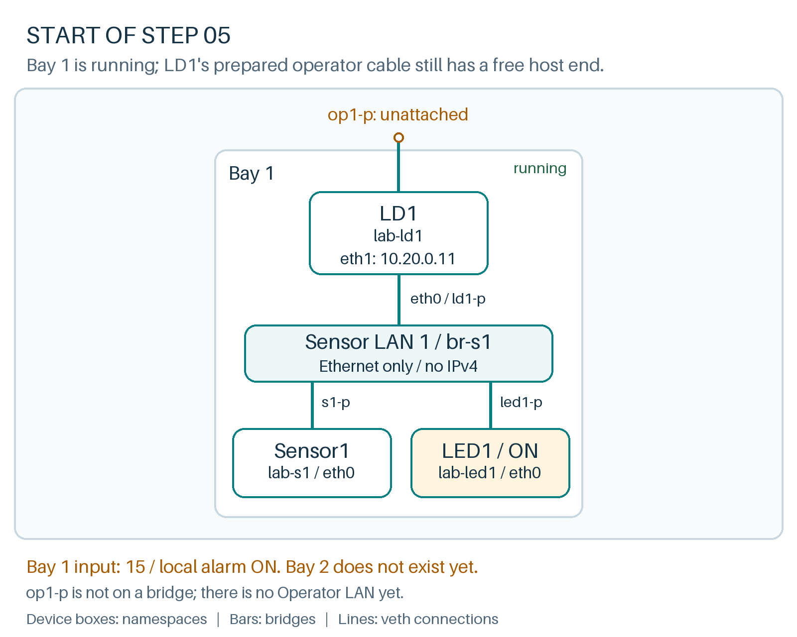

# Repeat the pattern without joining the LANs

**Where we are**

Bay 1 is running with input 15 and LED1 on. LD1 also has an addressed eth1, but its host-side peer op1-p is unattached. No second bay or Operator LAN exists yet.



**Goal:** build a second bay with the same structure and a separate Ethernet boundary.

For this exercise, a bay is a sensor, logical device and LED. We will repeat the first bay's topology. Reusing names such as `eth0` is safe; reusing the host-side port names would not be, because those ports all live in the host namespace.

| Bay 2 device | Namespace | Host-side port | Device interface |
|---|---|---|---|
| Sensor2 | `lab-s2` | `s2-p` | `eth0` |
| LD2 | `lab-ld2` | `ld2-p` | `eth0` |
| LED2 | `lab-led2` | `led2-p` | `eth0` |

Create the three stacks and their switch:

```bash
ip netns add lab-s2
ip -n lab-s2 link set lo up
ip netns add lab-ld2
ip -n lab-ld2 link set lo up
ip netns add lab-led2
ip -n lab-led2 link set lo up
ip link add br-s2 type bridge
ip link set br-s2 up
```{{exec}}

Connect Sensor2. Before clicking, identify which commands operate on the host and which on the sensor:

```bash
ip link add s2-p type veth peer name s2-n
ip link set s2-n netns lab-s2
ip -n lab-s2 link set s2-n name eth0
ip link set s2-p master br-s2
ip -n lab-s2 link set eth0 up
ip link set s2-p up
```{{exec}}

Connect LD2:

```bash
ip link add ld2-p type veth peer name ld2-n
ip link set ld2-n netns lab-ld2
ip -n lab-ld2 link set ld2-n name eth0
ip link set ld2-p master br-s2
ip -n lab-ld2 link set eth0 up
ip link set ld2-p up
```{{exec}}

Connect LED2:

```bash
ip link add led2-p type veth peer name led2-n
ip link set led2-n netns lab-led2
ip -n lab-led2 link set led2-n name eth0
ip link set led2-p master br-s2
ip -n lab-led2 link set eth0 up
ip link set led2-p up
```{{exec}}

Compare the two switches:

```bash
ip -br link show master br-s1
ip -br link show master br-s2
```{{exec}}

**Expected:** each command lists only its bridge's three ports:

| Command filters by | Ports shown |
|---|---|
| `master br-s1` | `s1-p`, `ld1-p`, `led1-p` |
| `master br-s2` | `s2-p`, `ld2-p`, `led2-p` |

All six ports should have the `UP` and `LOWER_UP` flags; interface indices and peer suffixes such as `@if14` may vary. An unfiltered listing can show ports from both bridges together; that does not mean the LANs are connected.

Both bridges exist on one Linux machine, but there is no Ethernet connection between them. Creating them in the same host namespace does not join their forwarding domains.

Do not start bay 2's programs yet. LD2 still needs its operator interface, which we will add next. A network can be built and inspected before any application uses it.

**Explain:** if Sensor1 transmits a multicast frame, what physical or virtual connection would be needed for that frame to enter `br-s2`? None exists here. Later, LD1 can send a new message on another LAN without forwarding Sensor1's original frame.

Click **Check** to verify bay 2's cabling. Keep bay 1 running at input 15.
