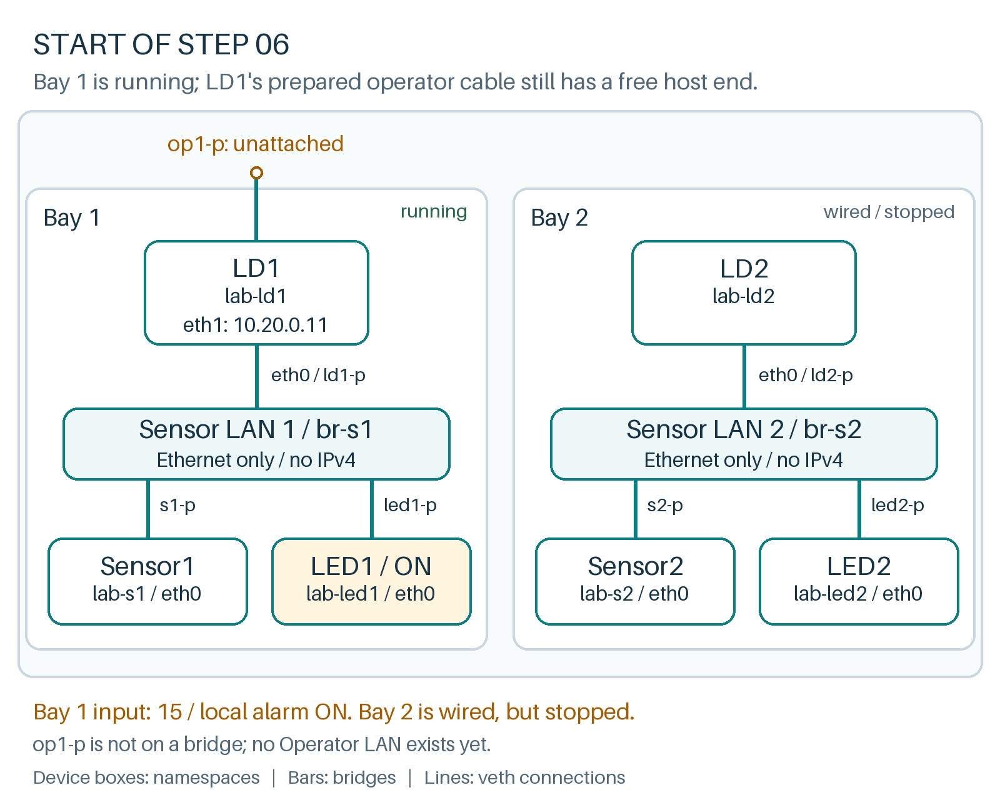

# Give logical devices a shared operator LAN

**Where we are**

Both Sensor LANs are wired and separate. Bay 1 is running; bay 2's programs are stopped. LD1's op1-p remains unattached, and LD2 has no operator interface yet.



**Goal:** connect two applications across an IP LAN while keeping their sensor LANs separate.

LD1 and LD2 each need two interfaces. Interface names are local labels, not built-in roles:

| Device interface | Connected network | Traffic in this example |
|---|---|---|
| LD1 `eth0` | `br-s1` | Sensor1 measurements and LED1 commands |
| LD2 `eth0` | `br-s2` | Sensor2 measurements and LED2 commands |
| LD1 and LD2 `eth1` | `br-op` | UDP alarm notifications and TCP status |

Create the operator switch and attach the host end of LD1's prepared cable:

```bash
ip link add br-op type bridge
ip link set br-op up
ip link set op1-p master br-op
```{{exec}}

Build LD2's second connection:

```bash
ip link add op2-p type veth peer name op2-n
ip link set op2-n netns lab-ld2
ip -n lab-ld2 link set op2-n name eth1
ip -n lab-ld2 addr add 10.20.0.12/24 dev eth1
ip link set op2-p master br-op
ip -n lab-ld2 link set eth1 up
ip link set op2-p up
```{{exec}}

Inspect addresses and routes before starting more software:

```bash
ip -br link show master br-op
ip -n lab-ld1 -4 address show dev eth1
ip -n lab-ld2 -4 address show dev eth1
ip -n lab-ld1 route show
```{{exec}}

**Expected:** two operator bridge ports, LD1 address `10.20.0.11/24`, LD2 address `10.20.0.12/24`, and a connected route to `10.20.0.0/24` through LD1's `eth1`. Linux added that route when we assigned the address. The devices are on the same subnet, so they do not need a router to reach one another. The bridge needs no address of its own.

Start bay 2 with a low input and query it **from LD1's namespace**:

```bash
cd /root/energy-lab
bash lab.sh voltage 2 5
bash lab.sh start 2
sleep 2
bash lab.sh status lab-ld1 10.20.0.12
ip -n lab-ld1 neigh show dev eth1
```{{exec}}

This TCP connection really crosses the operator bridge. The neighbour table should now map LD2's IPv4 address to a MAC address on `eth1`; ARP supplied that mapping. Its state may be `REACHABLE`, `STALE` or another normal neighbour state.

Both logical-device servers use port 10000. Inspect their separate TCP stacks:

```bash
ip netns exec lab-ld1 ss -lnt
ip netns exec lab-ld2 ss -lnt
```{{exec}}

**Expected:** each namespace has a listener on its own operator address at port 10000. These are independent socket tables. An address/port must be available within its own stack; separate namespaces can even reuse identical address/port combinations. Here we choose different operator IP addresses so peers on the shared LAN can reach the intended device. `ss -lnt` lists listening TCP sockets numerically; it does not list the Ethernet listener or UDP sockets.

## Separate local state from received notifications

With bay 1 at 15 and bay 2 at 5, LD2 should report:

```text
name: LD2
alerted_local: False
alerted_global: ['LD1']
```

`alerted_local` is LD2's own sensor comparison. `alerted_global` is the set of device names it has heard reporting an active alarm on the operator LAN, including its own publications. The word *global* refers to this small application's view, not guaranteed knowledge of the whole grid. LED2 remains off because only LD2's local comparison drives it.

Capture the notifications at LD2:

```bash
ip netns exec lab-ld2 timeout 8 tcpdump -l -eni eth1 -A -c 4 'udp port 10000'
```{{exec}}

**Expected:** packets to `224.0.0.1:10000` with payloads such as `LD1_ON` and `LD2_OFF`. This time there are IP and UDP headers. The kernel puts each UDP packet into an Ethernet frame for transmission on this LAN.

| Sensor LAN | Operator LAN |
|---|---|
| Custom EtherType `0x88b5`, no IP header | IPv4 and UDP, port 10000 |
| Measurement or `LOCAL_ON` / `LOCAL_OFF` | Device name plus `_ON` / `_OFF` |
| One bay's bridge | Shared operator bridge |

For the Python connection, open `helpers.py` in the editor: `send_L2_multicast` uses `AF_PACKET` and an interface name; `send_L3_multicast` uses `AF_INET`/UDP and selects the operator interface. The TCP server uses `AF_INET`/TCP. Namespace membership determines which Linux interfaces and IP stack these ordinary socket calls see.

`224.0.0.1` is the all-hosts link-local multicast group. It stays on this LAN; the sender uses TTL 1. We are not configuring multicast routing. LD1's Python code receives a measurement and creates a new operator notification; it does not bridge its two interfaces or route the original sensor frame.

Try an alarm in both bays, then clear only bay 2:

```bash
bash lab.sh voltage 2 15
sleep 2
bash lab.sh status lab-ld1 10.20.0.12
tail -n 2 run/led2.log
bash lab.sh voltage 2 5
sleep 2
bash lab.sh status lab-ld1 10.20.0.12
```{{exec}}

**Expected:** LD2 briefly has a local alarm and hears both active device names, then returns to local `False` with only `LD1` in its received alarm set. The sensor repeatedly publishes, so allow a couple of seconds for observations to converge. A stopped sender can leave stale global state: this example has no expiry or reliable event log.

Click **Check** with bay 1 high and bay 2 low.
